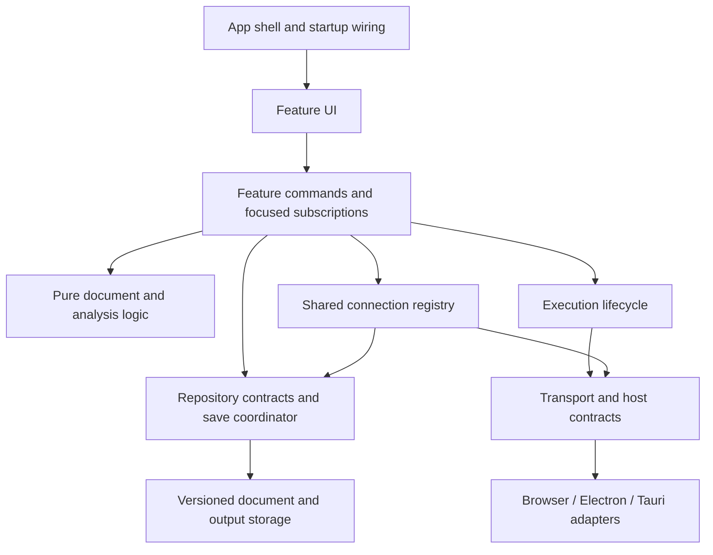

# Architecture review and migration plan

The product scope was clarified after this review: Data Prepper evaluation is local simulation. The optional Docker execution path described in the baseline was retired, and a port-3001 execution backend is not a prerequisite or planned deliverable.

Implementation has since begun. See [implementation status and verification](architecture-implementation.md) for delivered changes, verification limits, and remaining work. The findings and baseline measurements below describe the original review.

Reviewed 2026-09-26 against the current working tree, including pre-existing uncommitted changes. This is a proposal; application behavior has not been changed.

## Recommendation

Keep React, TypeScript, Vite, and a single application. Organize around Notebook, Investigations, Data Prepper, and ISM Analyzer, with explicit shared boundaries for connections, execution, persistence, and host capabilities. Migrate one behavior at a time behind the existing UI.

The central problem is unclear ownership of state and side effects. Changing UI frameworks or moving files alone would preserve that problem. A feature should own its documents and workflows; shared capabilities should own connections and platform access; one save coordinator should own durable writes.

Assumptions: retain the existing four features, local-first behavior, import/export compatibility, browser development, and both desktop hosts during migration. Whether both desktop hosts remain release targets is a product decision, not a prerequisite for fixing these boundaries.

## Findings, in priority order

### 1. Execution is coupled to whichever document is active at completion

`src/App.tsx:133` starts requests from the current notebook and later dispatches result and tracking updates. Result actions in `src/context/AppContext.tsx:292` contain a cell ID but no notebook ID or execution ID; the reducer searches `state.activeNotebook`. Tracking at `src/context/AppContext.tsx:370` also belongs to the currently active state. Investigations start execution inside `src/components/Investigation/InvestigationPPLCell.tsx:78` with similar cell-only updates.

Consequence: start a request in notebook A and switch to B before it completes. A's result is normally discarded because B does not contain that cell; tracking can be added to B. There is also no shared run identity to reject an older completion or prevent an older run from clearing a newer run's busy state. This is a control-flow finding; the review did not reproduce it in the running UI.

Change: make execution an application service. Every run retains document ID, cell ID, run ID, connection revision, and an immutable input snapshot. Completion and tracking target the originating document regardless of the visible feature. Define rerun behavior explicitly: cancel and supersede the previous run, and reject its late updates. Preserve the existing operation-tracking rules for HTTP/PPL/gRPC until deliberately revised.

### 2. Notebook editing has two implementations and multiple persistence paths

`src/context/AppContext.tsx:744` calls `notebookManager.updateCell`, which writes storage at `src/services/notebookManager.ts:240`, and then independently reconstructs the update through its reducer. The provider saves again through a debounce at `src/context/AppContext.tsx:637`. Its tracking effect also runs on notebook changes, and `src/services/persistence.ts:335` rewrites tracking both inside the notebook collection and under a separate key.

These paths already differ: `notebookManager.updateCell` protects cell identity and type, while the reducer spreads a general `Partial<Cell>`; the reducer handles the `__BEGINNING__` insertion sentinel, while the manager treats it as an unknown cell and appends. The persisted and displayed intermediate states can disagree. `REFRESH_NOTEBOOKS` also reads storage inside the reducer.

Change: one pure implementation of each document edit, narrow commands that cannot change cell identity, and one persistence owner. Pass timestamps/IDs into domain operations rather than obtaining them during reducer execution. Keep tracking in one authoritative record. Replace implicit autosave with observable dirty/saving/saved/error status and an explicit flush contract.

### 3. Connections have separate owners and inconsistent save semantics

The root AppProvider loads connections on mount. Investigations separately loads and updates its own collection in `src/components/Investigation/InvestigationWorkspace.tsx:39` and `:75`. Saving there does not update the root provider, which remains mounted across feature switches.

Notebook actions still call deprecated fire-and-forget persistence wrappers (`src/context/AppContext.tsx:864`, `src/services/persistence.ts:184`). `src/App.tsx:476` announces “Connection saved” immediately, before durable storage confirms success. Investigations awaits the asynchronous write.

Change: one application-wide connection registry with IDs and revisions. All features subscribe to it. Save and delete operations return promises and propagate errors. Publish a committed update after persistence succeeds, or explicitly represent an optimistic pending/error state. Invalidate metadata caches when endpoint/auth settings change, without putting credentials in cache keys.

### 4. Platform abstraction exists but does not govern all callers

`src/utils/platform.ts` offers unified APIs, but `src/utils/awsProfiles.ts` and the AWS helper in `src/utils/sigv4.ts:242` are Electron-only. `src/utils/crypto.ts:37` has its own Electron detection. `src/services/grpcExecutor.ts:22` branches directly across Electron, Tauri, and the Vite development bridge. `src/services/dockerExecutor.ts:25` and `:133` call the HTTP backend directly despite native Docker proxy APIs existing.

HTTP semantics also vary: `src/utils/platform.ts:224` removes AbortSignal at the Electron boundary, Tauri receives no signal, and the native result is exposed as a partial object cast to `Response`. Thus a browser timeout does not establish native cancellation parity. The Tauri proxy has no explicit per-request timeout in `src-tauri/src/main.rs`.

The most important contract defect is `src-tauri/src/storage.rs:15`: `safe_storage_encrypt` returns Base64, while real keyring functions exist separately and are unused by that command. The active credential utility currently takes the Electron/Web Crypto paths; this finding does not establish that existing Tauri credentials were saved using that Base64 command. Do not wire the generic native safe-storage abstraction into credential persistence until the Tauri implementation is corrected and tested.

Change: select adapters once during app startup. Expose typed, validated request/response contracts and explicit capabilities. Give native requests IDs and cancellation/deadline commands rather than trying to serialize AbortSignal. Use an honest transport response type with status, headers, body, and normalized errors. Define secret storage as put/get/delete by reference, with an accurate storage-protection capability; do not equate reversible encoding with encryption.

### 5. Document storage scales with the entire collection and embeds outputs

`src/services/persistence.ts:51` reads and serializes all notebooks to save one. `src/services/investigationPersistence.ts:89` does the same for investigations. Query/PPL/gRPC results live in cells (`src/types/cell.ts`), so large responses participate in document saves. Several loads use JSON parsing followed by type assertions rather than structural validation. Data Prepper and ISM contexts implement separate storage and suppress write errors.

Change: asynchronous repositories with versioned, validated records; separate document content, execution outputs, tracking, and small UI preferences. Start by wrapping the current format. Then migrate documents and bounded output storage to IndexedDB, with one record per document and transactional metadata updates. Keep small preferences in localStorage and native secrets behind a separate vault. IndexedDB is a proposed default for shared browser/desktop-renderer storage; verify persistence and upgrade behavior in both packaged hosts before rollout.

Web Storage is synchronous, while IndexedDB provides asynchronous structured storage. This makes IndexedDB a better candidate for growing documents/results, but responsiveness gains still require measurement. [MDN Web Storage](https://developer.mozilla.org/en-US/docs/Web/API/Web_Storage_API), [MDN IndexedDB](https://developer.mozilla.org/en-US/docs/Web/API/IndexedDB_API)

### 6. State subscriptions and rendering boundaries are too broad

`src/context/AppContext.tsx` is 986 lines and exposes `{state, dispatch}` through one context (`:654`). All its convenience hooks subscribe to that same value. Query-cell edits therefore invalidate unrelated context consumers. Each other feature provider similarly exposes a large combined value. React documents that consumers rerender when their context value changes; memoizing the whole object does not isolate a slice when `state` changes. [React useContext](https://react.dev/reference/react/useContext)

Change: separate document, execution, connection, and transient UI state. Subscribe editor cells by stable cell ID and read only their relevant snapshot. Use narrow contexts initially; introduce a selector-capable store for frequently updated document/execution state if profiling supports it. Keep React bindings at the UI boundary and avoid building a general-purpose state framework. The migration does not require choosing a new state library first.

### 7. Feature and editor boundaries need tightening

`src/App.tsx` is 644 lines and owns execution, profiling, tracking, role generation, import/export, connection dialogs, and feature composition. ISM analysis orchestration resides in `src/components/ISMAnalyzer/ISMPolicyAnalyzer.tsx:225`; Data Prepper combines persistence, validation, backend status, and execution in its context. `setTimeout(..., 0)` around pipeline simulation (`src/context/DataPrepperContext.tsx:192`) yields once but leaves computation on the UI thread.

All four feature entry points are statically imported by App. The measured production build emits a 1,307.53 kB main JavaScript chunk (371.07 kB gzip), plus a separate gRPC codec chunk. This is a loading opportunity, not a measured startup-latency result.

Change: thin app shell, lazy feature entry points, shared window chrome, and a shared editor integration for model identity, completion disposal, theme, and keyboard commands. Keep language-specific behavior separate. Move expensive simulation/analysis into workers only when representative traces show blocking. Render large results with pagination/virtualization when measurements justify it.

## What to preserve

- The useful domain modules already separated into TypeScript: parsers, validators, processor implementations, permission mapping, chart mapping, and timeline simulation. Audit browser/global dependencies before treating any module as pure.
- Existing property and integration tests. They protect behavior and should move with the modules rather than be rewritten to mirror the new folder layout.
- Monaco's existing scoped completion registration and disposal (`src/services/editorCompletions.ts:10`). Extend it rather than replacing it.
- Mapping-cache request deduplication, credential-sensitive identity, limits, and stale-context checks (`src/services/fieldMappings.ts:83`). Preserve these guarantees when moving cache ownership.
- The serialized connection storage transaction and legacy-migration recovery in the existing persistence service.
- Electron sender validation, navigation restrictions, localhost certificate restrictions, and desktop isolation. Refactoring adapters must preserve these protections.

## Target structure and dependency rules

```text
src/
  app/                     startup, dependency wiring, shell, feature loading
  features/
    notebook/              domain/, application/, state/, ui/
    investigation/         domain/, application/, state/, ui/
    dataprepper/           domain/, application/, state/, ui/
    ism/                   domain/, application/, state/, ui/
  connections/             shared registry, public metadata, credential references
  execution/               run lifecycle, cancellation, tracking, bounded outputs
  platform/
    contracts/             transport, vault, files, pipeline backend, capabilities
    browser/               browser and explicit development-bridge adapters
    electron/              renderer-side IPC adapters
    tauri/                 renderer-side command adapters
  storage/                 repositories, validation, migrations, save coordination
  editor/                  Monaco lifecycle and language-provider integration
  ui/                      generic controls, dialogs, theme, window chrome
electron/                  Node handlers grouped by capability
src-tauri/src/             Rust handlers implementing the same contracts
```

Each feature owns its types and policies. Shared modules contain genuinely shared contracts, not every helper. Create subdirectories when they contain meaningful modules; this is a destination, not an instruction to scaffold empty layers.



Domain code imports no React, storage globals, fetch, or host APIs. Application workflows use explicit dependencies. UI invokes workflows and subscribes to state; it does not encrypt credentials, select transports, or write storage. Only startup wiring selects concrete adapters. Features do not import another feature's private state/UI. Enforce those directions with lint import restrictions as each feature migrates.

Use direct typed function calls and small injected interfaces; a dependency-injection container, general event bus, plugin system, backend microservices, and a new monorepo are unnecessary for this scope.

## State and execution model

| State | Owner | Persistence policy |
| --- | --- | --- |
| Notebook/investigation cells, policy text, pipeline inputs | Feature document store | Versioned document repository |
| Connection metadata and revision | Shared registry | Connection repository |
| Saved secrets | Platform vault | Native vault where supported; explicit browser policy |
| Run identity, progress, cancellation | Execution service | In memory; bounded history if retained |
| Large response bodies and profiling outputs | Result repository/cache | Separate bounded records; preserve existing output behavior during migration |
| Mapping/index metadata | Shared metadata cache | Expiring; invalidate on connection revision |
| Selection, open dialogs, hover state | Local UI state | Usually transient |
| Theme/layout preferences | Small preference store | localStorage is sufficient |

A run snapshots its input and carries `{runId, documentId, cellId, inputRevision, connectionId, connectionRevision}`. Input edits make the previous output visibly stale; they do not relabel it as the result of new text. Starting a new run supersedes the previous active run for that cell. Completion is accepted only for the owning run, and never routed using the current selection. Deletion cancels or tombstones the owning run so results cannot resurrect deleted cells.

Track client cancellation honestly: canceling a transport does not guarantee OpenSearch rolled back or stopped processing a request. Do not automatically retry arbitrary user-issued operations. Restrict retries to safe metadata reads or explicitly approved semantics. Federated execution uses bounded concurrency and retains partial success with per-cluster errors.

For durable edits, the save coordinator tracks document revision and coalesces pending writes per document. It exposes status and errors, prevents an older write from replacing a newer revision, and offers `flush(documentId)` for controlled switches, exports, and desktop close. Browser termination cannot guarantee completion of an asynchronous flush: save continuously and define crash recovery rather than relying solely on unload events. Cross-window editing requires transactional revision/conflict handling, not only an in-memory queue.

## Migration plan

| Stage | Deliverable | Completion criteria |
| --- | --- | --- |
| 0. Establish behavior contracts | Lifecycle regression tests, supported-host capability matrix, representative performance fixtures | Cover switching documents during execution, editing connections across features, failed saves, and overlapping runs; record baseline load/edit/save timings |
| 1. Fix shared connections | One registry and awaited save/delete commands, using existing persistence format | Save failures stay visible; a change in Investigations appears in Notebook without reloading; connection-cache invalidation is verified |
| 2. Establish platform contracts | Typed browser/Electron/Tauri adapters and corrected secret-storage semantics | Feature services contain no host detection; native deadlines/cancellation are verified; Tauri vault stores and verifies secrets securely; no older-credential migration is needed for this first release |
| 3. Extract execution ownership | Run service and HTTP/PPL/gRPC/federated workflow adapters | Out-of-order results cannot overwrite newer results; tracking stays with its originating document; switching/deleting documents behaves predictably |
| 4. Make Notebook the first complete feature module | Pure document operations, one save coordinator, focused state subscriptions, thin Notebook UI | One edit has one authoritative state transition; coalesced saving survives controlled switches; no storage inside reducers/components; identity/order invariants hold |
| 5. Migrate persistence safely | Versioned repositories, per-document asynchronous storage, separate outputs, legacy migration | All existing valid fixtures round-trip; corrupt/unknown records are recoverable; interrupted migration retries; quota/conflict failures preserve usable data |
| 6. Apply the proven structure to other features | Investigations, Data Prepper, and ISM feature modules, shared editor integration | Feature behavior remains equivalent; shared connections/execution are reused; feature-local storage effects and duplicated host branches are retired |
| 7. Optimize measured costs | Lazy feature loading, optional workers and result virtualization, enforced import boundaries | Inactive features are absent from the initial feature bundle where separable; reference workloads meet recorded responsiveness budgets; no lifecycle regressions |

Split stages into reviewable pull requests. Each should retain a runnable application and remove the old owner when it switches a path. Do not dual-write through old and new code as a permanent migration strategy. Lazy feature imports can be delivered earlier as an independent change; execution and persistence correctness have higher priority.

Storage migration must validate before committing, retain legacy data until read-back verification succeeds, record migration status, and handle missing/deleted credential references. Preserve import/export formats through adapters. For rollback after new-format edits exist, use a verified compatibility export or reverse migration; retaining an old snapshot alone does not make code rollback safe. Treat user documents, secrets, and disposable output caches as different recovery classes.

The first implementation slice should be stage 1 plus its regression tests: it fixes a concrete cross-feature problem, provides a small example of the intended ownership model, and avoids starting with a whole-app rewrite.

## Validation and limits of this review

- `npm run lint`: passed.
- `npm run build`: passed; the main-chunk size warning is recorded above.
- Initial full Vitest run: 51 suites passed, one gRPC suite failed to open its local server because the sandbox denied `listen`; 957 tests passed and four were skipped in that run.
- The affected gRPC file was rerun with local-server permission: all 24 tests passed. The full suite was not rerun outside the sandbox; those 24 include tests already counted in the first run.
- No Electron/Tauri packaging, native Rust test run, live-cluster execution, runtime profiling, or browser interaction audit was performed. Performance recommendations are hypotheses supported by source/build evidence, not measured UI bottlenecks.
- The semantic search service returned an unavailable-index error; this review used direct source inspection.
- Pre-existing changes were preserved. Only this review document was added as the intended source change.

Add tests around behavior and boundaries during implementation: pure document invariants; execution races with controllable promises; storage migration and fault injection; capability contract suites for each adapter; native cancellation/vault integration; and a few end-to-end workflows for edit/save/reopen, connection updates, run/switch/rerun, and import/export. Existing unit/property coverage is a strong base, but it cannot alone demonstrate parity between packaged desktop hosts.
